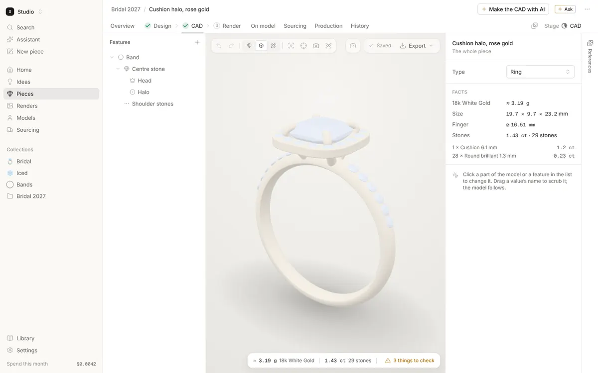
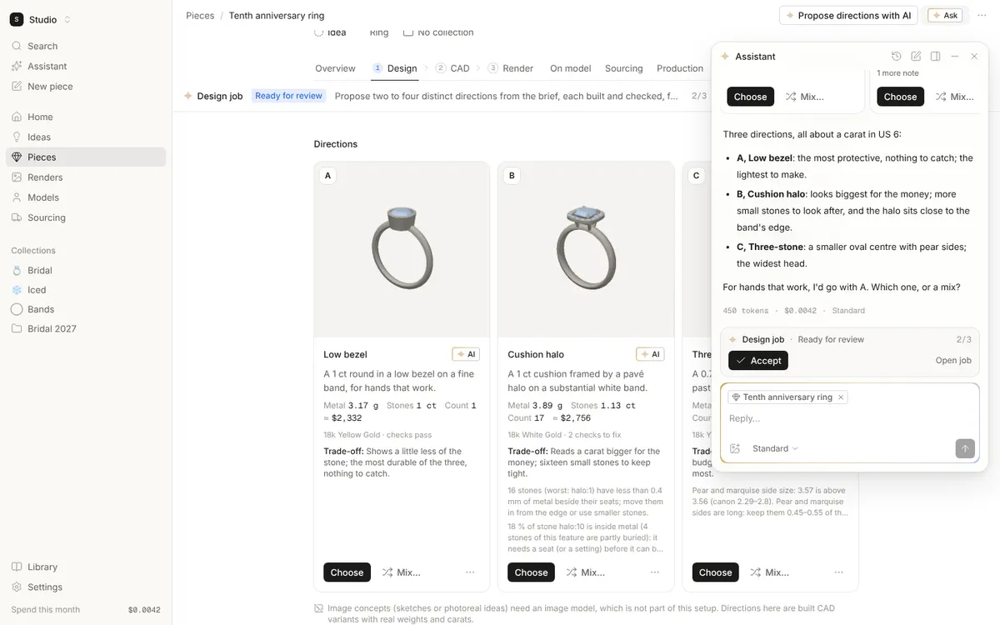
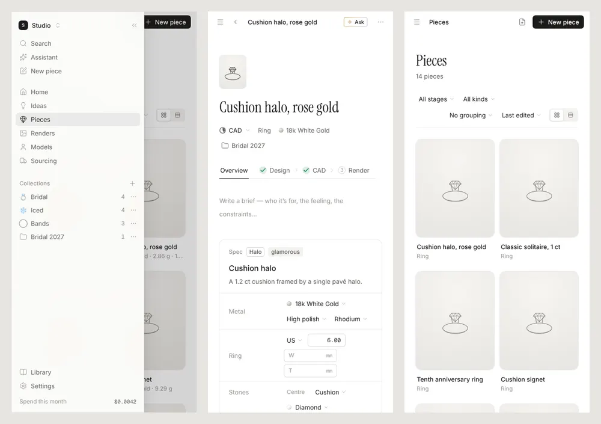

# Pavé design language

How Pavé looks and why, so that every new screen looks like it was always there. The tokens live in
one file, [`packages/ui/src/styles.css`](../packages/ui/src/styles.css); the components that use
them are in [`packages/ui/src/components`](../packages/ui/src/components). If a screen needs a
colour, size or effect that is not here, add it there first, with a comment on why.

The bar: Notion's calm structure and type, with the finish of the best pro tools. The jewellery is
the most colourful thing on the screen, and the chrome around it stays quiet, exact and warm.



## Tokens

| Group | Tokens | Rule |
|---|---|---|
| Surfaces | `bg`, `bg-subtle`, `bg-muted`, `bg-inset`, `bg-hover`, `bg-active` | Warm neutrals. Pages are `bg`; the window behind the sidebar is `bg-muted`. |
| Text | `fg`, `fg-muted`, `fg-subtle`, `fg-faint` | Four steps, no more. `fg-faint` is for placeholders and dividers in text. |
| Lines | `line`, `line-strong` | Hairlines, 1 px. Prefer a hairline to a box, and a box to a shadow. |
| Accent | `ink` (and `ink-fg`) | The one accent: primary buttons, the current tab's underline, the chosen state. |
| Selection | `select`, `select-soft` | Focus rings and selected things only. Never decoration. |
| Status | `ok`, `warn`, `danger` | Words first (“Ready to cast”, “3 things to check”); colour supports them. |
| AI | `ai-a`, `ai-b`, `ai-c`, `ai-spark` | Reserved for the assistant: its mark, the 1 px shimmer on what it made or is making. |
| Stage | `stage-a`, `stage-b` | The photographic sweep behind 3D and renders. Never pure white or pure black. |
| Glass | `glass`, `glass-strong`, `glass-line` | See the glass rules below. |
| Elevation | `shadow-sm`, `shadow-md`, `shadow-pop` | Only for things that float: chips over the stage, menus, dialogs, windows. |
| Motion | `ease-out`, `ease-in-out`, `dur-1` 120 ms, `dur-2` 180 ms, `dur-3` 260 ms | Short and purposeful. Everything stops under reduced motion. |

**Type.** Inter at 13 px for the interface (`text-sm`), on a 4 px grid. Shared type roles set the hierarchy throughout Studio. Use `studio-title` for page and project names (24–30 px), `studio-heading` for sections (18 px), and `studio-option` for cards and tools (14 px). Descriptions use regular 13 px Inter. Numbers that people compare use Geist Mono with tabular figures (`font-mono tabular`).

**Radii.** `xs` 4 (chips, keys), `sm` 6 (rows, inputs), `md` 8 (buttons, small cards), `lg` 12
(cards, menus, panels), `xl` 16 (dialogs, floating windows), `full` for pills. The only bracketed
radii are the outer ring of a 1 px gradient border, which is the inner radius plus one.

**Icons.** Lucide only, 16 px, stroke 1.5, set once in `PaveUIProvider`. 14 px (`size-3.5`) inside
small buttons and chips; 12 px (`size-3`) inside micro chips. No filled icons except the AI spark.

**Spacing.** Multiples of 4 px. Rows are 28 px (`h-7`) in lists and menus, 36 px (`h-9`) for
toolbars and tabs, 44 px (`h-11`) for the page header. Reading columns are 880 px; wide pages 1180 px.

## The glass rules

Glass makes floating chrome feel light and keeps the work visible behind it. It is never where
something must be read exactly.

1. **Glass is for floating chrome only:** the sidebar, toolbars and HUD controls over the viewport,
   the assistant pill, menus, popovers, the palette, dialogs, sheets, toasts and floating windows.
2. **Two strengths.** `glass` (72 % fill, 24 px blur) for chrome you glance at: toolbars, menus,
   the sidebar. `glass-strong` (86 % fill, 32 px blur) for surfaces you read: dialogs, sheets,
   the palette, toasts, the floating assistant and reference windows, the sidebar as a phone drawer.
3. **Never under stones, grades, prices or tables.** Weights, carats, dimensions and prices that
   float over the stage sit on a solid chip (`chip-solid`, or `bg-bg` with a hairline): the CAD HUD,
   the dimension tags, the Start-job popover's estimate, the plan-limit card. Cards inside a glass
   window (directions, takes) keep their own solid `bg`.
4. **Every glass surface has an opaque fallback.** Under *reduced transparency*, or where the
   browser has no `backdrop-filter`, glass becomes `bg-subtle`. Do not set a glass background
   inline (`style={{ background }}`): it would win over the fallback. The same fallback applies
   under `<html data-glass="solid">`, which a 3D view sets while the Performance setting is
   Smooth, or once Auto finds the machine cannot keep the view smooth: re-blurring a moving
   picture behind every toolbar on every frame halved the frame rate on a slow machine.
5. **Write `backdrop-filter` once, unprefixed.** The build adds the `-webkit-` prefix where it is
   needed. Writing both by hand made the build keep only the prefixed one, which Chromium and
   Electron ignore, so until this pass no glass in the app was actually frosted.



## Do and don't

| Do | Don't |
|---|---|
| Put the jewellery on the stage sweep; let metal and stone carry colour. | Tint chrome with brand colour, or put coloured panels behind content. |
| One primary (ink) action per view; the rest are secondary or ghost. | Two black buttons side by side. |
| Separate with space first, a hairline second. | Boxes inside boxes, or shadows on things that do not float. |
| Show loading as the shape of what comes (`Skeleton`, a slow light sweep). | A page-level spinner. Spinners are only for an action already under way inside its button. |
| Teach in empty states: a short heading, one sentence, one action. | “No data”. |
| Say errors quietly in one line, with Retry. | Red banners. |
| Use the AI shimmer on a 1 px border or the spark, while the assistant works or on what it made. | The shimmer as a fill behind text, or on anything a person made. |
| Keep motion under 300 ms, ease out, and let `prefers-reduced-motion` stop it. | Bounces, loops that never settle, or motion that carries meaning on its own. |
| Name the current page in a phone's header, with a back chevron to its parent. | A full breadcrumb that truncates every crumb. |
| Let rows of tabs or chips scroll sideways inside themselves on a phone (`scroll-fade-x`). | Anything that scrolls the whole page sideways. |
| Hide keyboard hints on touch screens (`Kbd` does this). | Show “Ctrl K” to someone holding a phone. |

## Moments of delight

Few, and each earns its place.

- **The AI shimmer.** While the assistant works, its status pill has the shimmer travelling slowly
  along a 1 px border (`ai-shimmer`), and the spark breathes. The inside stays solid and calm.
- **The render reveal.** A finished take or a new direction arrives with a short focus pull from
  soft to sharp (`reveal`, 520 ms). Under reduced motion it simply appears.
- **The CAD sweep.** When an assistant edit lands, one faint warm sweep crosses the stage and the
  changed parts glow for 1.8 s.

## Phones

Below 768 px the sidebar becomes a drawer, opened from the header's menu button and closed by its
scrim, Escape or any navigation. The header names only the current page, with a back chevron. The
piece's tab row and the settings sections scroll sideways inside themselves. Galleries are two
columns. The assistant fills the screen and folds to its pill. Every screen is checked at 390 × 844.



## Checking a screen

`apps/studio/e2e/polish.ts` photographs every screen and state (light and dark, 1440 × 900 and
390 × 844, and with reduced motion and reduced transparency) against the real server, and reports
any sideways scrolling. Run it before and after a visual change and look at both sets side by side.

```sh
pnpm --filter @pave/studio build
PORT=8799 PAVE_DATA_DIR=$(mktemp -d) PAVE_RENDER_NONE=1 \
  PAVE_ASSISTANT=scripted:design-directions npx tsx apps/server/src/main.ts
npx tsx apps/studio/e2e/polish.ts http://127.0.0.1:8799 /tmp/polish light 1440
```
