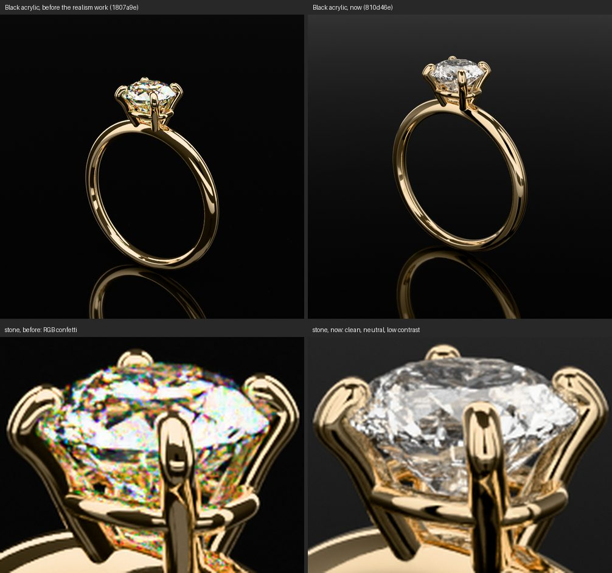
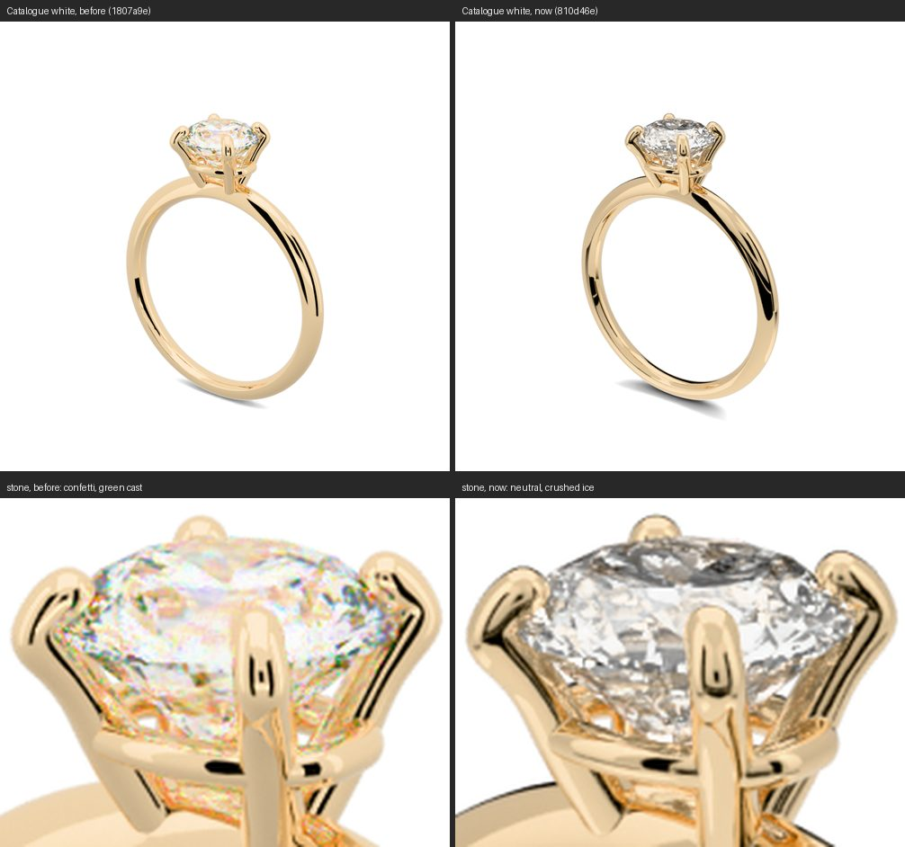

# 24 — Render realism, measured

26 November 2026. The founder rendered on his laptop and wrote that the renders "don't scream
realism" and that "the black acrylic for one looks really bad". This note says what was changed
in the product's renders (branch `render/realism`, commits `c352eb3` to `810d46e`), why, what is
still weak, and what can only be measured on the founder's Mac or a GPU.

Every change was rendered with and without it through the product's own chain (canon recipe,
kernel, GLB, `resolveScene`, the Blender worker; Blender 5.3.0, Cycles on two CPU threads of a
shared 4-core Linux machine, no GPU) and looked at whole and cropped on the stone and the
ground. The pairs, numbers and twelve more comparison images are in
[`spikes/25-look-realism/`](spikes/25-look-realism/README.md). The rules a future render agent
needs are in the render skill (`.claude/skills/jewelry-render/SKILL.md`, section 7, "Lighting and
grounds by scene type"); the in-app assistant's short version is in
`packages/agent/src/prompt/skills/cinema.ts` and `render.ts`. The rules that can be tested are
tests: `packages/render/src/looks.test.ts`, `resolve.test.ts`, `workers/render/tests/`.

## Before and now

**Black acrylic** (18k solitaire, hero, 768 px, 64 samples). Before: a void (black room, black
sheet, black background), a stone of red-green-blue confetti, gold olive-brown where the band
faced the camera. Now: a charcoal glow behind the piece that the sheet mirrors as a gradient, a
soft mirror image that fades, amber gold with one bright line down each side and dark edges
kept, and a clean, neutral stone. Still weak, seen in the crops: the stone reads as faceted
glass, with few deep blacks and no fire; the gold's mirror image is a dim olive-brown; the mirror
image is cut by the bottom edge.

**Catalogue white** (same piece and settings). Before: a beige band with no darks, a stone of
pastel confetti with a green cast, a faint smear for a shadow. Now: dark strokes along each face
of the band, a contact shadow falling toward the camera, a neutral stone with readable facets.
Still weak: the gold is pale beside a retouched photo, and the stone is light grey crushed ice
with almost no black facets.

## What changed, and why

| Change | Why (what the with-and-without pair showed) |
|---|---|
| Panels 1 to 3.5 times display white, the room well under 1 (were 4 to 9 in a room near 1) | Polished metal mirrors the rig, so a light's strength is its brightness in the picture. The old tent made gold cream and the diamond flat white. The largest single change. |
| Walls behind the camera at or under 1.2 on white sets | Gold mirrors those walls over most of a band; above about 1.2 the view transform's shoulder takes the yellow out (1.6 cream, 1.1 amber). |
| Main softbox above and behind (64 to 70° up), not overhead | The contact shadow falls toward the camera, where it is seen. |
| Emitter strength as a shader constant | Cycles samples emitters by those constants; with strength in a vertex colour the Daylight sun cast no shadow at any sample count. |
| Black acrylic: the camera sees a horizon glow (0.26), the sheet is two planes, the rig is kept out of the camera's view of the sheet | A black void became a surface with a gradient; a high camera no longer sees the top softbox as a grey rectangle on the "black". |
| Black acrylic and Studio contrast: a long low softbox behind the camera; on black acrylic two thin strips just off the lens axis | From 22° up the front and underside of a band mirror the floor and the low room behind the camera, black on a dark set: that was the olive "dirty brass". With the strip the band is gold. The strips draw one line down each side. |
| Black acrylic: camera at 16° or more, turned 15° when raised from face-on; aim dropped 15 % of the half frame | From 6° the camera saw the glow as a grey wall with a hard line; the mirror image was cut mid-band. |
| White sets: a black card low in front, gradient side cards placed with a one-bounce reflection map, all for the metal only | Draws the dark stroke along each face of a band; puts a dark-to-bright run on a flat band side. |
| Stones see a dimmer room (`ambient.stones`) and get their own two white cards beside the lens | A bright room left no dark for a diamond to show; a face-up stone then mirrored the dim room and stayed slate grey (p50 142) until its cards lit the table (p50 222 to 234). |
| Metal seen through a stone keeps 30 % of its colour | A colourless centre stone in rose gold read as morganite (R − B 33, now 14). Deliberately not physical. |
| Dispersion off at every tier, and a stone-colour check that fails a take above 5 % | Cycles 5.3's dispersion is RGB, not spectral: it converged to a colour mosaic (22 % of stone pixels at 384 samples, 14.6 % at 1024), never to fire. With it off: 0.1 %. |
| Glossy bounces equal to transmission (24 drafts, 32 takes); Khronos PBR Neutral in every look; 0.1 mm edge rounding in shading; every animation frame on one seed | Stones no longer go dark from paths that ran out; gold keeps its colour (AgX turned it rose-beige); flat-sided bands catch a hairline on their edges; held frames stop boiling. |
| 18k yellow gold checked, not changed | Its colour is within ΔE 1 of ISO 8654's 2N. The paleness on white is the light, not the alloy; a test holds it. |
| Daylight's sun lowered to 30°, Editorial warm lit at 5000 to 5600 K with a separate backdrop light | Daylight got a long crisp shadow, its own look; 3400 K lights had turned gold copper and platinum rose. |

## What remains weak

From the last review (verify-2, renders at `810d46e`), each confirmed by a crop:

- **Bright-look stones lack black facets.** Face-up studs on Studio soft have 1.3 % of stone
  pixels darker than 60 of 255 (three-stone 0.5 %). A reviewer's pair at `ambient.stones` 0.05
  instead of 0.3 gave 6.4 % with the median unchanged at 224: the arrows came back with no loss
  of whiteness. Not yet applied to `looks.ts`.
- **Editorial warm floats.** The backdrop light that removed the hot band at the horizon casts no
  shadow from the piece, so it also fills the key's contact shadow (darkest ground under the
  three-stone 146 against 70 on a 217 ground). Stones stay champagne (R − B 51) and the band is
  one flat peach plane. Proposed: split the sweep into floor and wall and light only the wall.
- **Orange seat holes inside a rose-gold shank** are unchanged (94 orange pixels against 102),
  though an earlier note called them gone. They are light bouncing metal to metal in the drilled
  seats, which the through-stone desaturation does not reach.
- **Flat band faces** on white sets still read as evenly lit planes: the gradient cards moved
  only the darkest and brightest tenths (median L* 68 and 77, against about 55 to 60 wanted).
- **Look identity.** Studio soft and Catalogue white are the same light on two backdrops;
  Daylight's sun puts no pinpoint glints on the stones.
- **Earrings** are framed small (5 % of the frame) and face-on at 6° in the bright looks, so each
  stud reads as a flat disc; the black-acrylic rule (16° up, turned 15°) reads far better.
- **The stone-colour check lives only in the look-tuning script.** The server path that ships
  takes (`apps/server/src/engines/render`) does not yet reject a take over 5 %.
- Also open: the flat outer face of a flat-sided band is gunmetal on black acrylic; 1.8 mm and
  smaller pavé is dull grey beads in every look; a hanging pendant stands on its lowest point
  with the chain rising out of frame (the scene has no notion of a hanging piece: a product
  decision); gold on white is colour-true but paler than retouched photos (a selective yellow
  lift was deliberately not added); Studio contrast is dark overall; the browser preview's gold
  is a little darker and browner than Cycles on the dark looks; no fire at any tier.
- **No render has been compared with a photograph of a real piece**, and every outside source was
  read as a search summary because the session could not open pages.

## What needs the founder's Mac or a GPU

- **His own judgement on his screen.** "Looks really bad" was judged on his laptop. The two
  sheets above, and one solitaire take in each look at 1600 px, should be looked at there; what he
  still faults goes into the skill's library as a correction, quoted.
- **A real piece against its photograph.** One family piece with its 3dm, rendered in Catalogue
  white and black acrylic and set beside a photograph of the same piece under a known light. This
  is the only test of whether the gold colour, the stone contrast and the mirror image are true,
  and the library (`aska-render-lib`, on his Mac) is where it would be recorded.
- **Final-tier cost and look.** 1024 samples at 1600 to 2048 px was not timed (800 px took 218 to
  330 s on black acrylic here), and pavé sparkle can only be judged at that size: at 768 px a
  0.9 mm stone is five pixels. Finals and animation at final quality are not feasible on two CPU
  threads.
- **GPU repeatability.** The kit's Metal launch line was assembled from Blender's source and never
  run. A GPU take should match the CPU preview to Blender's own test rule (at most 1 % of pixels
  differ by more than 0.016), and the seed-per-frame rule has not been watched on a fast camera
  move.
- **Fire.** Cycles 5.3 cannot trace it cleanly. A spectral path (the plan's own renderer, stage 3
  of `docs/plans/jewelry-renderer.md`, or a separate fire pass) needs GPU time to measure against
  the current white-flash-only stones.
- **The browser preview on Apple hardware.** Its frame time and its gold against Cycles were
  checked only in a headless Linux browser.
